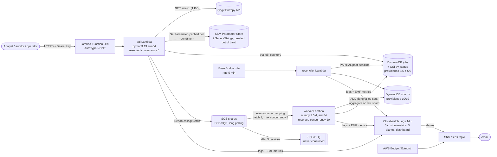

# Quantum-seeded Monte Carlo on AWS Lambda

> **One-line description (≤ 120 characters):** _to be written by Paawan before submission._

A serverless, Terraform-managed Monte Carlo service that prices a European call
option. Every job is seeded from one 1 KiB block of Qrypt quantum entropy, fans
out across SQS-driven Lambda workers with independently derived shard seeds,
aggregates to a price with a 95% confidence interval, and can be **replayed**
from its stored seed to recompute the same float64 result.

Status (2026-10-14): code, tests and Terraform are complete and `terraform plan`
is clean. Deployed to a dev stack on 2026-10-14 with reserved concurrency
temporarily off while the Lambda concurrency quota increase is pending (see
[Known constraints](#known-constraints)). The 1M-path job, replay and benchmarks
have been measured there, and the fail-closed and DLQ alarm tests passed.

## Contents

- [Architecture](#architecture)
- [Grader quick-start](#grader-quick-start)
- [API](#api)
- [Web console](#web-console)
- [How correctness is checked](#how-correctness-is-checked)
- [Failure handling](#failure-handling)
- [Security](#security)
- [Cost: the $0 arithmetic](#cost-the-0-arithmetic)
- [Benchmarks](#benchmarks)
- [Known constraints](#known-constraints)
- [What this system does not do](#what-this-system-does-not-do)
- [Repository layout and development](#repository-layout-and-development)

## Architecture



Terraform layout (`infra/`): one root module and five child modules.

| Module | Creates |
|---|---|
| `data` | `jobs` table (+ `by_status` GSI) and `shards` table, provisioned capacity, TTL 7 days |
| `workers` | shard queue + DLQ (redrive, maxReceiveCount 3), private S3 bucket for the worker zip, worker function + role + log group, SQS event-source mapping, reconciler function + role + log group + 5-minute EventBridge rule |
| `api` | api function + role + log group, Function URL, the two URL resource-policy statements |
| `observability` | SNS topic + policy + email subscription, 5 alarms, dashboard |
| `budget` | $1/month AWS Budget (alerts at any actual spend and at 100% forecast) |

### Job lifecycle

1. `POST /jobs` validates the body, takes a token from our own Qrypt rate limiter
   (14 per fixed 10 s window, so any 10 s span stays at or under 28 < Qrypt's 30),
   reserves 1 KiB against the entropy ceiling, and fetches one 1 KiB block from
   Qrypt. **Any** Qrypt failure rejects the job (see [fail-closed](#failure-handling)).
2. Master seed = `SHA-256("qmc/master-seed/v1" || block)` (256 bits). The job
   stores the seed hex, the SHA-256 of the raw block, the fetch time,
   `entropy_source: "qrypt"` and Qrypt's request id if the response carried one
   (otherwise `null`, never an invented value).
3. The job is written as `QUEUED` and its shards are enqueued with
   `SendMessageBatch` (10 per call).
4. A worker derives its shard seed as numpy `SeedSequence(master, spawn_key=(i,))`
   (identical to `SeedSequence(master).spawn(n)[i]`), draws normals from PCG64 in
   fixed chunks of 262,144, and writes `{n, sum, sum_sq}` as float64 hex with a
   conditional put on `job_id + shard_index`.
5. It then `ADD`s its index to the job's `done_shards` number set (idempotent).
   The worker that sees every shard accounted for wins a conditional
   `RUNNING → AGGREGATING` flip, sorts the partials by `shard_index`, reduces with
   `math.fsum`, and writes `COMPLETE` with estimate, standard error and 95% CI (as
   float64 hex plus a display decimal), plus the Black-Scholes distance in SEs.
6. `POST /jobs/{id}/replay` creates a new job linked to the original, with the
   original's seed and parameters and **no Qrypt call**. Workers recompute every
   shard; on completion the job records a field-by-field hex comparison and a
   verdict that reads `bit-identical` only if all four values match.

## Grader quick-start

Prerequisites: AWS CLI v2 and Terraform ≥ 1.10 authenticated to a sandbox
account in `us-east-1`; Python 3.13; a Qrypt Entropy token.

**Before the first apply** (once per account):

1. Set a budget alarm in the console (Billing → Budgets, "Zero spend" template).
   Terraform also creates a $1 budget, but the console one exists before any apply.
2. Check the Lambda "Concurrent executions" quota (Service Quotas). It must be at
   least **115** (reserved 10 + 5, plus the 100 Lambda insists stay unreserved).
   New accounts start lower; request an increase and wait for approval.
3. Store the two secrets as SSM SecureStrings, off camera, never through Terraform:

   ```bash
   # Qrypt token: paste it into a file first so it is not in shell history
   aws ssm put-parameter --name /qrypt-mc/qrypt-api-key --type SecureString --value file://qrypt-token.txt
   # API bearer key: 32+ random characters
   python3 -c "import secrets;print(secrets.token_urlsafe(32))" > api-key.txt
   aws ssm put-parameter --name /qrypt-mc/api-key --type SecureString --value file://api-key.txt
   shred -u qrypt-token.txt api-key.txt
   ```

**Deploy, run, replay, destroy:**

```bash
python3 -m venv .venv && . .venv/bin/activate && pip install -r requirements-dev.lock
python scripts/build.py                      # build/api.zip, worker.zip, reconciler.zip

cd infra
# State: GitLab-managed Terraform state (see scripts/tf-init.sh), or for a quick
# local trial replace `backend "http" {}` in versions.tf with nothing and run `terraform init`.
GITLAB_HOST=... GITLAB_PROJECT_ID=... GITLAB_TOKEN=... ../scripts/tf-init.sh
export TF_VAR_alarm_email=you@example.com    # confirm the SNS email AWS sends
terraform apply                              # ~34 resources
cd ..

export QMC_API_URL=$(terraform -chdir=infra output -raw api_url)
export QMC_API_KEY=$(aws ssm get-parameter --name /qrypt-mc/api-key --with-decryption --query Parameter.Value --output text)

python scripts/qmc_cli.py submit --paths 1000000 --shards 10 --wait   # standard case
python scripts/qmc_cli.py replay <job_id> --wait                      # replay_comparison.verdict
python scripts/qmc_cli.py bundle <job_id> > bundle.json && python scripts/verify.py bundle.json

terraform -chdir=infra destroy
```

The bearer key is fetched from SSM by the grader; it is never printed in this
README, in Terraform outputs or in logs.

## API

All routes except `GET /` require `Authorization: Bearer <key>`.

| Method and path | Result |
|---|---|
| `POST /jobs` | `202 {job_id, status: "QUEUED", master_seed_hex, ...}`. Body: `{S0, K, r, sigma, T, paths, shards}` |
| `GET /jobs` | `{jobs: [...], next_before}` newest first; `?status=&limit=&before=`. Empty list on a fresh deployment |
| `GET /jobs/{id}` | the job record with `progress` (shards done/failed), then `result` when `COMPLETE`; `404` with a message for an unknown id |
| `POST /jobs/{id}/replay` | `202` new job with `replay_of`; `409` if the original is not `COMPLETE` or the runtime fingerprint differs |
| `GET /jobs/{id}/bundle` | parameters, seed, provenance and hex results for `scripts/verify.py` |
| `GET /health` | table status, configuration and last-success times (see [Known constraints](#known-constraints)) |
| `GET /system` | limits, entropy used vs ceiling, Qrypt rate limit, DLQ depth, runtime fingerprint |

Input limits (Terraform variables): `paths ≤ 10,000,000`, `shards ≤ 100`,
`paths/shards ≤ 2,000,000`, `shards ≤ paths`, `0 < sigma ≤ 5`, `0 < T ≤ 50`,
`0 < S0, K ≤ 1e6`, `-1 ≤ r ≤ 1`. Every violation is listed in the 400 body.

## Web console

`GET /` on the Function URL serves a small static console (HTML, CSS and
vanilla JS shipped inside the api zip; no framework, no third-party scripts, no
analytics). It covers the three users in the brief:

- **Analyst**: New job, prefilled with the standard case, with the same limits
  the server enforces, a Black-Scholes preview and the entropy cost; Job detail
  shows progress per shard, then the estimate, SE, 95% CI and the distance from
  Black-Scholes in standard errors.
- **Auditor**: Provenance (entropy source, Qrypt request id or "not provided by
  Qrypt", master seed, block hash, runtime fingerprint), Replay with a
  no-new-entropy confirmation, a field-by-field float64 hex comparison, and a
  bundle download for `scripts/verify.py`.
- **Operator**: System view with health, entropy used against the ceiling, limits,
  fault-injection state and DLQ depth; `PARTIAL` jobs show failed shard indexes and error codes.

The bearer key is kept in `sessionStorage` for the tab only and sent only as an
`Authorization` header to the same origin. Every page carries a "Demo — synthetic
data only" banner, `noindex`, and a strict Content-Security-Policy.

`tests/e2e/console_smoke.mjs` drives it with Playwright (connect, wrong key → 401,
client validation, submit → `COMPLETE` within 3 SE, replay → bit-identical,
fault-injected shard → `PARTIAL`, no horizontal scroll at 390 px). It passes
against the moto-backed local server in `tests/e2e/local_server.py`; it has not
yet run against a deployment.

## How correctness is checked

All by committed tests (`pytest`, 211 tests including the adversarial set, 93% line+branch coverage of `src/qmc`;
CI gate 80%). Nothing is verified by a model's say-so.

| Property | Test |
|---|---|
| Price within 3 SE of Black-Scholes (10.4506 for S0=100, K=100, r=0.05, σ=0.2, T=1; 3 SE ≈ 0.044 at 1M paths) | `test_blackscholes.py::test_fixed_seed_within_3_se`: deterministic, fixed seed (master seed of an all-zero block, chosen before the first run), also asserts a rerun is bit-identical |
| Same, as a real statistical test | `test_blackscholes.py::test_fresh_seed_within_3_se`: fresh OS entropy each run. **Expected to fail about 0.27% of runs** (1 in ~370) if the code is correct. Its tolerance and seed are never changed to make a run pass; a failure prints the seed |
| Shard seeds distinct; same master → same shard seeds | `test_seed.py` (1,000 distinct shard seeds; spawn-key derivation equals `spawn()`) |
| Bit-identical replay | `test_aggregate.py::test_replay_recompute_is_bit_identical` and `test_pipeline.py::test_replay_is_bit_identical_and_uses_no_entropy`: `==` on float64 hex of estimate, SE and both CI bounds. Never `pytest.approx` |
| Aggregation independent of completion order | `test_aggregate.py::test_order_of_completion_does_not_matter` |
| Idempotent shards under duplicate delivery | `test_pipeline.py::test_duplicate_delivery_does_not_double_count` |
| Fail-closed seeding | `test_api.py::test_qrypt_failure_rejects_job_and_creates_nothing` (401, 403, 429, 500, 503, timeout, unreachable, key unavailable) and `test_qrypt.py` |
| Worker failure → `PARTIAL`, never `COMPLETE` | `test_pipeline.py::test_failing_shard_ends_partial_never_complete`, reconciler tests |
| No secrets in logs | `test_api.py::test_logs_never_contain_auth_header_or_body` |
| Mock never packaged | `test_packaging.py` |

Deployed checks (run after `apply`; results to be committed under `bench/`): a
1M-path job within 3 SE, a replay with verdict `bit-identical`,
`scripts/deployed_failclosed_test.py` (real network failure → rejection, no job
created), and a fault-injected shard tripping the DLQ alarm and email.

Run on 2026-10-14 (details and job ids in `bench/deployed-checks-2026-10-14.md`):
the 1M-path job gave 10.453436 (SE 0.014719, z = +0.19 against 10.450584), and
its replay and the offline `verify.py` both came out `bit-identical` on the
float64 hex of estimate, SE and CI bounds. The fail-closed test passed (504
`qrypt_timeout`, no job created), and a fault-injected shard ended its job
`PARTIAL` and tripped the shard-failure and DLQ-depth alarms. The first attempts were all rejected because Qrypt's
Cloudflare front blocks urllib's default User-Agent; fixed in bb71747.

### Is replay really bit-identical?

On the same deployed runtime, yes by construction and by test: the shard seed,
the chunked draw order, numpy's pairwise `sum` per chunk and the `math.fsum`
reduction in shard order are all deterministic, and results are stored as
float64 hex, so equality is literal.

The caveat: numpy picks SIMD kernels for `exp()` at runtime from the CPU's
features, and Lambda hosts are not guaranteed identical. Each job records the
numpy version, architecture and algorithm version it expects; each shard records
the numpy version, architecture and a hash of the CPU features it actually ran
on. A replay is refused if numpy, architecture or algorithm version differ, and
a result whose shards ran on different CPU-feature sets is flagged
`runtime_consistent: false`. The verdict is `bit-identical` only when all four
hex values match; otherwise it says `different` and shows the values. On the
deployed stack (2026-10-14) a 1M-path replay matched on all four hex values,
even though its shards ran on two different CPU-feature sets
(`runtime_consistent: false`); `verify.py` on an x86_64 machine matched too.
That is one job, not a proof for every host.

## Failure handling

- **Qrypt unavailable (401/403/429/500/503/timeout/network) → job rejected.**
  The response is `503` (`504` on timeout) with `error: "entropy_unavailable"`,
  the named `cause`, Qrypt's HTTP status and `job_created: false`. There is no
  fallback to `os.urandom`, `secrets`, `random`, `time`, `uuid` or any local
  source: CI greps `src/` for those and fails on a hit. Job ids are derived by
  hashing (block hash + time), so the deployed code needs no local randomness at all.
- **Mock Qrypt client**: lives in `tests/fakes/`, injected by tests through the
  `App` constructor, absent from every zip (asserted), and selectable by no
  environment variable. A missing or invalid token makes submit fail closed.
- **Burst of submissions**: our limiter returns `429` with `Retry-After` before
  Qrypt is called. An entropy ceiling (default 5,000 KiB of the 10,240 KiB
  assessment budget) returns `409` once reached.
- **Duplicate SQS delivery**: shard writes are conditional puts; completion
  tracking uses DynamoDB number sets, so a redelivered message changes nothing.
- **Worker failure**: after 3 receives the message goes to the DLQ (which nothing
  consumes, so the depth alarm fires). On the last receive the worker records the
  failure, and the job ends `PARTIAL` with `failed_shard_indexes` and
  `shard_errors`. No result is written for a `PARTIAL` job.
- **Timeouts and crashes**: the reconciler runs every 5 minutes and marks jobs
  still active 15 minutes after submit as `PARTIAL`, listing the missing shards.
  It also re-aggregates a job whose aggregator died mid-write.
- **Lambda timeout**: the per-shard cap (2M paths) keeps a shard far below the
  30 s worker timeout; oversized `paths/shards` ratios are rejected at submit.
- **Fault injection (test path in deployed code)**: `enable_fault_injection`
  (default `false`) lets a job name `fail_shards` that raise in the worker. It
  exists to demonstrate the DLQ alarm with a genuinely failing worker. When the
  variable is false the API rejects `fail_shards` and the worker ignores the flag.

## Security

- **No model at runtime, and untrusted text stays data**: there is no language
  model anywhere in submit, workers, aggregation, replay or the console, so no
  input can steer a model. The untrusted channels are the HTTP request (body,
  path, query), the Qrypt response, and stored values the console displays.
  Structural controls: every job field is validated as a bounded number before
  any entropy is spent; job ids must match a fixed hash format; a Qrypt request
  id is kept only if it is an opaque token (`[A-Za-z0-9._:-]{1,128}`), otherwise
  it is stored as null; the console writes values with `textContent`, never
  `innerHTML`. `eval/adversarial/` holds hostile-text cases for each channel
  (instruction-like text, HTML/script, SQL and shell metacharacters, template
  syntax, bidi overrides): all 56 job-field cases (8 strings × 7 fields) are rejected with 400 before
  any Qrypt call, all hostile path ids get 400/404, and all hostile request ids
  are dropped.
- **Secrets**: the Qrypt token and the API bearer key are SSM SecureStrings
  created out of band (CLI or console). Terraform only builds their ARNs from the
  names to scope IAM; there is deliberately **no** `data "aws_ssm_parameter"`,
  because it decrypts by default and would put the plaintext into state and plan
  output. They are never Terraform variables, Lambda environment variables,
  outputs, or in `.env.example`. The api function reads each once per container
  and caches it (one KMS decrypt per cold start). `/health` never decrypts.
- **API auth**: the Function URL is `AuthType=NONE` with an **application-layer
  key check on a public endpoint**: the handler compares the bearer key in
  constant time, rejects bodies over 4 KB before parsing, and serves only the
  static console without a key. Unauthenticated calls still invoke (and bill)
  the function; reserved concurrency 5 is the only throttle a Function URL has.
  `AWS_IAM` auth was rejected because a browser console cannot sign SigV4
  requests without adding Cognito. Checkov `CKV_AWS_258` is suppressed with that reason.
- **IAM**: one role per function, each limited to its own table, index, queue,
  parameters and log group. No `*` in any Action or Resource. Exactly two
  documented wildcard-principal statements, both required by AWS for a NONE-auth
  Function URL: `lambda:InvokeFunctionUrl` for `Principal: *` scoped by
  `lambda:FunctionUrlAuthType = NONE`, and `lambda:InvokeFunction` for
  `Principal: *` scoped to invocations via the Function URL. Custom metrics use
  CloudWatch Embedded Metric Format (log lines), so no `cloudwatch:PutMetricData`
  wildcard is needed at all.
- **Encryption**: DynamoDB with AWS-owned keys, SQS with SSE-SQS, TLS everywhere.
  Customer-managed KMS keys were rejected on cost (~$1/month each); Checkov
  `CKV_AWS_119` and similar are suppressed with that reason, inline.
- **Logging**: an allow-list logger emits request id, method, path (with job ids
  collapsed), status, job id, shard index and error codes only. Events, bodies
  and headers are never logged. Log groups are declared in Terraform with 14-day retention.
- **Public demo rules**: `noindex` (header and meta), no third-party analytics,
  a persistent "Demo — synthetic data only" banner in the console, DynamoDB TTL
  purges jobs and shards after 7 days, and the API key is rotated after grading.
- **CI**: gitleaks as a pre-commit hook and in CI; a staged-diff credential and
  PRD check; Checkov with inline reasons for each suppression.

## Cost: the $0 arithmetic

Workload: 100 jobs/day × 1,000,000 paths × 10 shards = 3,000 jobs/month.
Allowances are the always-free monthly figures, which must be re-checked at
aws.amazon.com/free before relying on them (last checked: _pending_). Lambda
durations below are **estimates until the benchmarks run**; the table will be
replaced by measured values.

| Service | Usage per month | Always-free allowance | Headroom |
|---|---|---|---|
| Lambda requests | 3,000 submits + 30,000 shard invocations + ~90,000 status polls (30/job) + 8,640 reconciler runs ≈ 132k | 1M | ~87% |
| Lambda compute | worker ~0.3 s × 1 GB × 30,000 = 9,000 GB-s; api ~0.2 s × 0.5 GB × 93,000 = 9,300 GB-s; reconciler ~0.5 s × 0.25 GB × 8,640 = 1,080 GB-s ≈ 19,400 GB-s (estimate, includes billed INIT for cold starts) | 400,000 GB-s | ~95% |
| DynamoDB | provisioned 20 RCU + 20 WCU across both tables and the GSI; storage < 100 MB (TTL 7 days) | 25 RCU, 25 WCU, 25 GB per account per region | 5 RCU/WCU |
| SQS | idle long polling by the event-source mapping ≈ 0.26–0.65M requests (5 pollers shrinking to 2, 20 s waits) + jobs: 3,000 × (1 batch send + 10 receives + 10 deletes) ≈ 63k + `/system` reads | 1M | ~29% worst case |
| KMS | 2 SecureString decrypts per api cold start (cached for the container's life); never from `/health` | 20,000 requests | large |
| CloudWatch | 5 custom metrics (dimensions Environment + Function only; never a job id), 5 alarms, 1 dashboard; logs well under 5 GB | 10 metrics, 10 alarms, 3 dashboards, 5 GB logs | |
| SNS | a handful of alarm publishes + emails | 1M publishes, 1,000 emails | |
| EventBridge | scheduled rule, 8,640 invocations | scheduled rules are not charged | |
| SSM Parameter Store | 2 standard parameters, standard throughput | no charge | |
| S3 | one private bucket holding the ~16 MB worker zip (needed because the AWS provider cannot upload a zip this large inline); a PUT per code change and a GET per deploy | 5 GB, 2,000 PUTs and 20,000 GETs for the first 12 months only; after that about $0.0004/month | not always-free |
| Budgets | 1 budget created by Terraform (+1 created in the console) | first 2 budgets free | |

Not used, because none is always-free: NAT gateways, load balancers, EC2, RDS,
Secrets Manager, API Gateway, X-Ray, customer-managed KMS keys, Step Functions
(the stretch would exceed its 4,000 free state transitions at this volume
unless Express workflows are used).

**AWS Budgets is a backstop, not a limiter**: it evaluates spend a few times a
day, so alerts arrive hours late and stop nothing. The real cost limiters are
reserved concurrency (worker 10, api 5), `maximum_concurrency` 5 on the SQS
event-source mapping, the per-job `paths`/`shards` caps, and the DLQ
`maxReceiveCount` of 3. Costs on the deploying account are the deployer's own.

The budget screenshot (account id redacted) will be added after the first apply.

## Benchmarks

Measured with `scripts/bench.py` against the deployed stack, real Qrypt calls,
nothing stubbed. Raw JSON lands in `bench/`.

| Target | Value | Result |
|---|---|---|
| Submit latency, warm, 50 submissions | < 800 ms p95 | **619.8 ms p95**, 325.1 ms p50, 739.6 ms max; first request 561.7 ms (2026-10-14, client in a us-east cloud container) |
| 1M paths submit → `COMPLETE`, 5 runs | < 60 s | **1.07 s median**, 1.4 s max; all 5 `COMPLETE`, all within 3 SE of Black-Scholes (worst z = −2.07) |
| `terraform apply` from empty | < 10 min | _not yet measured_ |
| Steady-state cost at 100 jobs/day | $0 | arithmetic above; durations to be replaced with measured values |

## Known constraints

Where the PRD and this project's guardrails disagree, the guardrail wins and the
conflict is recorded here.

| Topic | PRD asks | This build does, and why |
|---|---|---|
| IAM wildcards | no `*` actions or resources | No `*` in any Action or Resource. Two wildcard **principals** on the Function URL permissions, which AWS requires for `AuthType=NONE`, both condition-scoped (above) |
| IaC scanner | Checkov or tfsec | Checkov; tfsec is deprecated into Trivy |
| API auth | `AWS_IAM` or bearer key | bearer key, described as an application-layer key check on a public endpoint that still invokes and bills |
| Health endpoint | checks DynamoDB and SSM reachability | `DescribeTable` on both tables plus configuration and last-success times. It never decrypts an SSM parameter (that would spend KMS requests on monitoring), so SSM reachability is reported as the last successful key load in that container |
| Mock Qrypt client | mock so tests run without a token | exists only in `tests/`; no environment variable can switch deployed code to it |
| Replay claim | bit-identical | claimed only when the float64 hex test passes; otherwise the system reports `different` and shows the values |
| Correctness test | one test within 3 SE | two tests: fixed-seed deterministic, and fresh-seed statistical with its ~0.27% expected failure rate stated |
| Fault injection | forced failure for the demo | off by default behind a Terraform variable; when on, a real worker raises |
| CI provider and OIDC | GitHub repository, GitHub Actions | the repository is on a self-hosted GitLab, so CI is GitLab CI and AWS access in CI uses GitLab OIDC `id_tokens` to assume an IAM role (no long-lived keys). The IAM OIDC provider and the CI role (trusted only for this project's `main` branch, permissions scoped to `qmc-*` resources) are defined in `infra/bootstrap/`, to be applied once by an administrator; not applied yet. Plan/apply jobs stay disabled until `AWS_ROLE_ARN` is set |
| CI runners | CI runs on every push | the GitLab instance's only runner is offline, so pipelines currently sit `pending`; every CI check was run locally instead (see the commit history) |
| Ephemeral per-branch stacks (stretch) | GitHub Actions apply/destroy | not built yet |
| Step Functions (stretch) | allowed | not used: it would break the $0 target at 100 jobs/day |

Other constraints:

- **Lambda concurrency quota.** Reserved concurrency of 15 (worker 10, api 5)
  needs an account quota of at least 115, because Lambda keeps 100 unreserved.
  New accounts start lower, so request the increase before the first `apply`.
  This account started at 10. From 2026-10-14 until the increase was approved
  on 2026-10-15, the dev stack ran with no reservations (`-1`), a temporary
  exception the candidate approved. The deployed checks and benchmarks in
  `bench/deployed-checks-2026-10-14.md` were measured in that state. The
  reservations were re-applied on 2026-10-15 and a second plan showed no drift.
- **Qrypt provides no signed receipt.** Provenance proves the seed matches a
  stored block hash; it cannot prove Qrypt produced the block. We describe it as
  externally attestable seed provenance, not "true randomness" or guaranteed
  independence: shard independence comes from `SeedSequence` spawn keys, and the
  Qrypt block supplies the master seed's provenance.
- **PARTIAL from a timeout is late.** It appears after the reconciler's next run,
  up to 20 minutes after submit (15-minute deadline + 5-minute schedule).
- **Capacity.** 25 WCU total means a 100-shard job can briefly throttle; the SDK
  retries with backoff and `max_shards` bounds it.
- **Rate limiter.** Fixed 10 s windows of 14 keep any 10 s span at or under 28
  requests per deployment. Two deployments sharing one Qrypt token would need to
  split that budget.
- **Entropy ledger** counts 1 KiB per Qrypt attempt, including failed ones, so it
  over-counts slightly rather than under-counts.
- **Unverified vendor facts.** The Qrypt endpoint, size limits and error codes
  are from the assessment brief and Qrypt's EaaS docs as cited there; whether the
  post-July-2025 AWS Free plan includes Budgets, SSM and Function URLs, and the
  free allowances for EventBridge and Budgets, have not been re-checked against
  current AWS pages from this environment.

## What this system does not do

- It runs without reserved concurrency for now (see the concurrency quota),
  and the alarm email was not checked from here (only the alarm states).
- It prices one product: a European call under Black-Scholes GBM. No portfolio
  VaR, no other payoffs, no variance reduction.
- It does not queue jobs when Qrypt is down (`PENDING_ENTROPY` is a stretch not
  built); such jobs are rejected.
- It does not prove that Qrypt produced a block (no vendor receipt exists).
- It does not authenticate users individually: one shared bearer key gates the API.
- It does not make AWS bills impossible; it bounds them and alerts late.
- It is not compliant with any regulatory regime and holds synthetic parameters only.

## Repository layout and development

```
src/qmc/              deployed code (packaged into Lambda)
  params.py           input validation and limits
  qrypt.py            Qrypt REST client (no fallback)
  seed.py             master and shard seed derivation
  sim.py              shard simulation (numpy)
  aggregate.py        fsum aggregation, hex comparison
  jobs.py             lifecycle and finalization
  store.py            DynamoDB / SQS access
  handlers/           api, worker, reconciler entry points
tests/                pytest suite; tests/fakes/ holds the mock Qrypt client
scripts/              build, CI checks, client, verify, benchmarks
infra/                Terraform root module and modules/
```

```bash
python3 -m venv .venv && . .venv/bin/activate && pip install -r requirements-dev.lock
pytest --cov                      # unit + moto-backed handler tests
ruff check src tests scripts
mypy                              # typecheck src/qmc
scripts/check_seed_path.sh        # no local entropy in src/
python scripts/build.py           # reproducible zips
pre-commit install --hook-type pre-commit --hook-type pre-push
# pre-commit (~1 s, staged files): ruff, gitleaks, credential/PRD check, seed grep, terraform fmt
# pre-push (~15 s warm): mypy + full unit suite. Never bypass with --no-verify.
```

AI assistance is disclosed in [AI_USAGE.md](AI_USAGE.md); licenses in [LICENSES.md](LICENSES.md).
