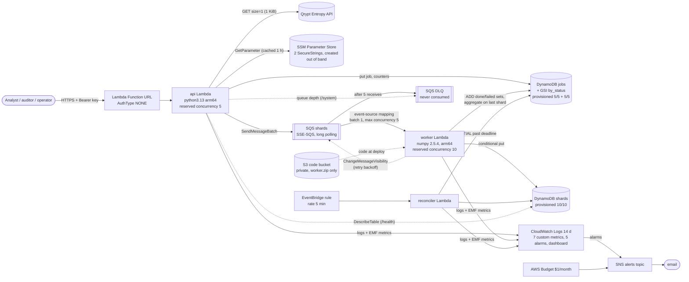
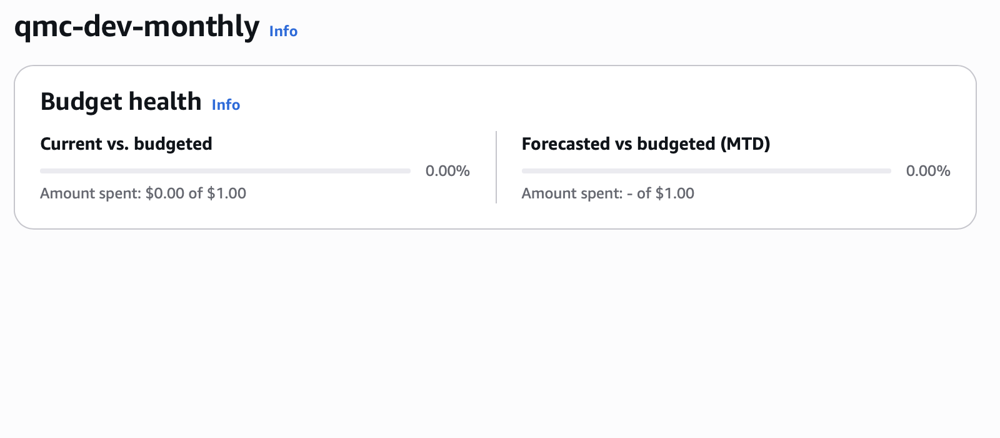
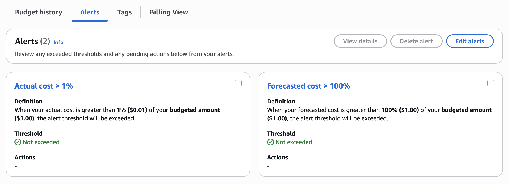

# Quantum-seeded Monte Carlo on AWS Lambda

> Serverless Quantum Monte Carlo option pricer on AWS, seeded by Qrypt entropy, with bit-identical replay and $0 cost.

**Deployed endpoint:** <https://tiszf5ypkbkclttornac5wabgu0lscrt.lambda-url.us-east-1.on.aws/>
(web console at [`/#/new`](https://tiszf5ypkbkclttornac5wabgu0lscrt.lambda-url.us-east-1.on.aws/#/new)).
Every API route needs the bearer key. For this deployment the candidate sends it
to the graders privately with the submission (it is never committed). In your own
deployment you read it from SSM as shown in the [quick-start](#grader-quick-start).
The stack stays up through grading, then is destroyed and the key rotated.

**Demo video:** _(link added with the submission)_

A serverless, Terraform-managed Monte Carlo service that prices a European call
option. Every job is seeded from one 1 KiB block of Qrypt quantum entropy, fans
out across SQS-driven Lambda workers with independently derived shard seeds,
aggregates to a price with a 95% confidence interval, and can be **replayed**
from its stored seed to recompute the same float64 result.

Status (2026-10-16): code, tests and Terraform are complete and deployed to a
dev stack in `us-east-1`, with reserved concurrency in place (worker 10, api 5)
and `terraform plan` showing no drift. The 1M-path job, replay, latency and
wall-clock benchmarks were re-measured there on 2026-10-16 with the reservations
on; the fail-closed test passed, and after the last code change (main 7978c46)
a fresh job, its replay and a fault-injection run were checked live, with the
alarm emails received (`bench/deployed-checks-2026-10-16-mr9.md`).

## Contents

- [Architecture](#architecture)
- [Grader quick-start](#grader-quick-start)
- [API](#api)
- [Web console](#web-console)
- [How correctness is checked](#how-correctness-is-checked)
- [Failure handling](#failure-handling)
- [Security](#security)
- [Cost: the $0 arithmetic](#cost-the-0-arithmetic)
- [Benchmarks](#benchmarks)
- [Known constraints](#known-constraints)
- [What this system does not do](#what-this-system-does-not-do)
- [Repository layout and development](#repository-layout-and-development)

## Architecture



Not drawn, to keep the picture readable: the three IAM roles and their inline
policies, the Lambda permissions, the queue and topic policies, and the S3
bucket's sub-resources. The table below lists every resource Terraform creates.

Terraform layout (`infra/`): one root module and five child modules.

| Module | Creates |
|---|---|
| `data` | `jobs` table (+ `by_status` GSI) and `shards` table, provisioned capacity, TTL 7 days |
| `workers` | shard queue + DLQ (redrive, maxReceiveCount 5, visibility timeout 180 s), private S3 bucket for the worker zip, worker function + role + log group, SQS event-source mapping, reconciler function + role + log group + 5-minute EventBridge rule |
| `api` | api function + role + log group, Function URL, the two URL resource-policy statements |
| `observability` | SNS topic + policy + email subscription, 5 alarms, dashboard |
| `budget` | $1/month AWS Budget (alerts when actual spend passes 1%, i.e. $0.01, and when forecast spend passes 100%; spend counted before credits and refunds) |

Every resource in the main stack (39):

| Module | Resources |
|---|---|
| `api` (7) | `aws_lambda_function.api`, `aws_lambda_function_url.api`, `aws_lambda_permission.url_invoke`, `aws_lambda_permission.url_invoke_function`, `aws_iam_role.api`, `aws_iam_role_policy.api`, `aws_cloudwatch_log_group.api` |
| `data` (2) | `aws_dynamodb_table.jobs` (with the `by_status` GSI), `aws_dynamodb_table.shards` |
| `workers` (20) | `aws_sqs_queue.shards`, `aws_sqs_queue.dlq`, `aws_sqs_queue_redrive_allow_policy.dlq`, `aws_lambda_event_source_mapping.shards`, `aws_lambda_function.worker`, `aws_iam_role.worker`, `aws_iam_role_policy.worker`, `aws_cloudwatch_log_group.worker`, `aws_s3_bucket.code`, `aws_s3_bucket_public_access_block.code`, `aws_s3_bucket_server_side_encryption_configuration.code`, `aws_s3_bucket_lifecycle_configuration.code`, `aws_s3_object.worker_zip`, `aws_lambda_function.reconciler`, `aws_iam_role.reconciler`, `aws_iam_role_policy.reconciler`, `aws_cloudwatch_log_group.reconciler`, `aws_cloudwatch_event_rule.reconcile`, `aws_cloudwatch_event_target.reconcile`, `aws_lambda_permission.reconcile` |
| `observability` (9) | `aws_sns_topic.alerts`, `aws_sns_topic_policy.alerts`, `aws_sns_topic_subscription.email`, 5 × `aws_cloudwatch_metric_alarm.this` (worker-errors, dlq-depth, api-errors, qrypt-failures, shard-failures), `aws_cloudwatch_dashboard.main` |
| `budget` (1) | `aws_budgets_budget.monthly` |

The separate `infra/bootstrap/` stack (applied once per account) holds the CI
identity: `aws_iam_openid_connect_provider.gitlab`, `aws_iam_role.ci`, and its
inline policies `deploy` and `deny_self_edit`. The two SSM parameters are created
out of band and are not in either stack.

### Job lifecycle

1. `POST /jobs` validates the body, takes a token from our own Qrypt rate limiter
   (14 per fixed 10 s window, so any 10 s span stays at or under 28 < Qrypt's 30),
   reserves 1 KiB against the entropy ceiling, and fetches one 1 KiB block from
   Qrypt. **Any** Qrypt failure rejects the job (see [fail-closed](#failure-handling)).
2. Master seed = `SHA-256("qmc/master-seed/v1" || block)` (256 bits). The job
   stores the seed hex, the SHA-256 of the raw block, the fetch time,
   `entropy_source: "qrypt"` and Qrypt's request id if the response carried one
   (otherwise `null`, never an invented value).
3. The job is written as `QUEUED` and its shards are enqueued with
   `SendMessageBatch` (10 per call).
4. A worker derives its shard seed as numpy `SeedSequence(master, spawn_key=(i,))`
   (identical to `SeedSequence(master).spawn(n)[i]`), draws normals from PCG64 in
   fixed chunks of 262,144, and writes `{n, sum, sum_sq}` as float64 hex with a
   conditional put on `job_id + shard_index`.
5. It then `ADD`s its index to the job's `done_shards` number set (idempotent).
   The worker that sees every shard accounted for wins a conditional
   `RUNNING → AGGREGATING` flip, sorts the partials by `shard_index`, reduces with
   `math.fsum`, and writes `COMPLETE` with estimate, standard error and 95% CI (as
   float64 hex plus a display decimal), plus the Black-Scholes distance in SEs.
6. `POST /jobs/{id}/replay` creates a new job linked to the original, with the
   original's seed and parameters and **no Qrypt call**. Workers recompute every
   shard; on completion the job records a field-by-field hex comparison and a
   verdict that reads `bit-identical` only if all four values match. Replays
   spend no entropy, so a daily cap (100 per UTC day by default) bounds what a
   key holder can make the workers compute.

## Grader quick-start

Prerequisites: AWS CLI v2 and Terraform ≥ 1.10 authenticated to a sandbox
account; Python 3.13 (`python3.13`); a Qrypt Entropy token. Everything runs in
`us-east-1`, so every AWS CLI command below names that region.

**Before the first apply** (once per account):

1. Set a budget alarm in the console (Billing → Budgets, "Zero spend" template).
   Terraform also creates a $1 budget, but the console one exists before any apply.
2. Check the Lambda "Concurrent executions" quota (Service Quotas). Reserved
   concurrency needs at least **115** (reserved 10 + 5, plus the 100 Lambda keeps
   unreserved). New accounts often start at 10. Either request an increase, or
   for a short trial apply without reservations by adding
   `-var worker_reserved_concurrency=-1 -var api_reserved_concurrency=-1`
   (this removes the hard cap on parallel spend; the event-source mapping's
   maximum concurrency of 5 and the per-job limits still apply). Pass the same
   two flags on every later `apply` and `destroy`, or put them in a gitignored
   `infra/terraform.tfvars`, or a later apply will try to reserve 10 + 5 and fail.
3. Store the two secrets as SSM SecureStrings, off camera, never through Terraform.
   Write the files without a trailing newline (the API strips one anyway):

   ```bash
   # Qrypt token: paste it into a file first so it is not in shell history
   printf '%s' "$(cat qrypt-token.txt)" > qrypt-token.txt.clean && mv qrypt-token.txt.clean qrypt-token.txt
   aws ssm put-parameter --region us-east-1 --name /qrypt-mc/qrypt-api-key --type SecureString --value file://qrypt-token.txt
   # API bearer key: 32+ random characters
   python3 -c "import secrets,sys;sys.stdout.write(secrets.token_urlsafe(32))" > api-key.txt
   aws ssm put-parameter --region us-east-1 --name /qrypt-mc/api-key --type SecureString --value file://api-key.txt
   shred -u qrypt-token.txt api-key.txt   # macOS has no shred: use rm -P
   ```

**Deploy, run, replay, destroy:**

```bash
python3.13 -m venv .venv && . .venv/bin/activate && pip install -r requirements-dev.lock
python scripts/build.py                      # build/*.zip; plan, apply and destroy all read them

# Local state for your own account (the file is gitignored). Never point a trial
# at this project's GitLab state: its default state name is the live "dev" stack.
printf 'terraform {\n  backend "local" {}\n}\n' > infra/backend_override.tf
terraform -chdir=infra init
export TF_VAR_alarm_email=you@example.com    # then click the link in the SNS email AWS sends
terraform -chdir=infra apply                 # 39 resources

export QMC_API_URL=$(terraform -chdir=infra output -raw api_url)
export QMC_API_KEY=$(aws ssm get-parameter --region us-east-1 --name /qrypt-mc/api-key --with-decryption --query Parameter.Value --output text)

python scripts/qmc_cli.py submit --paths 1000000 --shards 10 --wait   # standard case
python scripts/qmc_cli.py replay <job_id> --wait                      # replay_comparison.verdict
python scripts/qmc_cli.py bundle <job_id> > bundle.json && python scripts/verify.py bundle.json

terraform -chdir=infra destroy               # needs build/*.zip and TF_VAR_alarm_email too
```

`terraform destroy` removes all 39 resources. Left behind on purpose: the two
SSM parameters and the console budget (delete them in the console if wanted).
The project's own CI uses GitLab-managed state through `scripts/tf-init.sh`. To
use that path instead, delete `infra/backend_override.tf` (with it in place
`tf-init.sh` fails), export `GITLAB_HOST`, `GITLAB_PROJECT_ID`, `GITLAB_TOKEN` (a
token with `api` scope) and a `TF_STATE_NAME` of your own (the default is the
live `dev` state), run `scripts/tf-init.sh`, then export `TF_HTTP_USERNAME=oauth2`
and `TF_HTTP_PASSWORD="$GITLAB_TOKEN"` before `apply` and `destroy`, because the
script sets them only for its own `init`.

To see the DLQ alarm fire with a genuinely failing worker (the demo path),
turn fault injection on, submit a job that names a failing shard, then turn it
off again:

```bash
terraform -chdir=infra apply -var enable_fault_injection=true
python scripts/qmc_cli.py submit --paths 1000 --shards 2 --fail-shards 0 --wait   # ends PARTIAL
terraform -chdir=infra apply                 # fault injection back off
```

The shard is received 5 times before it reaches the DLQ. After each failure the
worker releases the message after 10, 20, 30, 40 and 50 s, so it lands in the
DLQ about 2.5 minutes after submit (measured on dev 2026-10-15, one run: job `PARTIAL` at 107 s, DLQ depth 1 at 162 s); CloudWatch can take a few more minutes to
move the alarm. The `worker-errors` alarm trips on the first failed attempt.
The DLQ is never consumed, so its alarm stays in `ALARM` until the queue is
purged; purge it before a second recording or no new notification is sent:

```bash
aws sqs purge-queue --region us-east-1 --queue-url "$(terraform -chdir=infra output -raw dlq_url)"
```

**Recording or sharing a screen**: the AWS account id appears in `terraform apply`
progress lines (queue URLs, SNS and budget ids), in the fault-injection diff (the
functions' environment), and in alarm emails, whose footer also holds a working
unsubscribe link. The queue-URL outputs are marked sensitive. Mask the rest by
planning to a file and applying that file, each piped through an unbuffered
`sed` (an interactive `apply` piped through `sed` hides its "Enter a value:"
prompt), and blur the email's account and footer lines:

```bash
terraform -chdir=infra plan -out=demo.tfplan 2>&1 | sed -u -E 's/[0-9]{12}/XXXXXXXXXXXX/g'
terraform -chdir=infra apply demo.tfplan 2>&1 | sed -u -E 's/[0-9]{12}/XXXXXXXXXXXX/g'
```

The plan file is gitignored; it holds the account id and the alarm email, so
delete it afterwards.

The bearer key is read from SSM by whoever deployed the stack; it is never
printed in this README, in Terraform outputs or in logs.

## API

All routes except the console (`GET`/`HEAD /` and `/static/*`) require `Authorization: Bearer <key>`.

| Method and path | Result |
|---|---|
| `POST /jobs` | `202 {job_id, status: "QUEUED", master_seed_hex, ...}`. Body: `{S0, K, r, sigma, T, paths, shards}` |
| `GET /jobs` | `{jobs: [...], next_before}` newest first; `?status=&limit=&before=`. Empty list on a fresh deployment |
| `GET /jobs/{id}` | the job record with `progress` (shards done/failed), then `result` when `COMPLETE`; `404` with a message for an unknown id, `400 invalid_job_id` for one that is not 32 hex characters |
| `POST /jobs/{id}/replay` | `202` new job with `replay_of`; `409` if the original is not `COMPLETE` or the runtime fingerprint differs; `429` with `Retry-After` once the daily replay cap is reached (100 per UTC day by default) |
| `GET /jobs/{id}/bundle` | parameters, seed, provenance and hex results for `scripts/verify.py` |
| `GET /health` | `200` or `503`: both tables `ACTIVE` and SSM reachable (`GetParameter` with `WithDecryption=false`, so the check itself spends no KMS request; authenticating the request may decrypt the key, cached for 1 hour), plus configuration and last-success times |
| `GET /system` | limits, entropy used vs ceiling, Qrypt rate limit, DLQ depth, runtime fingerprint |

Input limits: `paths ≤ 10,000,000`, `shards ≤ 100`, `paths/shards ≤ 2,000,000`
(these three are Terraform variables), `shards ≤ paths`, `0 < sigma ≤ 5`,
`0 < T ≤ 50`, `0 < S0, K ≤ 1e6`, `-1 ≤ r ≤ 1` (fixed in `src/qmc/params.py`).
Every type and range violation is listed in the 400 body; missing or unknown
fields are reported first, on their own.

## Web console

`GET /` on the Function URL serves a small static console (HTML, CSS and
vanilla JS shipped inside the api zip; no framework, no third-party scripts, no
analytics). It covers the three users in the brief:

- **Analyst**: New job, prefilled with the standard case, with the same limits
  the server enforces, a Black-Scholes preview and the entropy cost; Job detail
  shows progress per shard, then the estimate, SE, 95% CI and the distance from
  Black-Scholes in standard errors.
- **Auditor**: Provenance (entropy source, Qrypt request id or "not provided by
  Qrypt", master seed, block hash, runtime fingerprint), Replay with a
  no-new-entropy confirmation, a field-by-field float64 hex comparison, and a
  bundle download for `scripts/verify.py`.
- **Operator**: System view with health, entropy used against the ceiling, limits,
  fault-injection state and DLQ depth; `PARTIAL` jobs show failed shard indexes and error codes.

The bearer key is kept in `sessionStorage` for the tab only and sent only as an
`Authorization` header to the same origin. Every page carries a "Demo — synthetic
data only" banner, `noindex`, and a strict Content-Security-Policy.

`tests/e2e/console_smoke.mjs` drives it with Playwright (connect, wrong key → 401,
client validation, submit → `COMPLETE` within 3 SE, replay → bit-identical,
fault-injected shard → `PARTIAL`, no horizontal scroll at 390 px). It passes
against the moto-backed local server in `tests/e2e/local_server.py`. It was
also run by hand against the deployed stack on 2026-10-15 for every step except
the fault-injected shard (which needs fault injection on); that run's output was
not committed.

## How correctness is checked

All by committed tests (`pytest`, 236 tests including the adversarial set, 3 of which skip until `scripts/build.py` has run; 94% line+branch coverage of `src/qmc`;
CI gate 80%). Nothing is verified by a model's say-so.

| Property | Test |
|---|---|
| Price within 3 SE of Black-Scholes (10.4506 for S0=100, K=100, r=0.05, σ=0.2, T=1; 3 SE ≈ 0.044 at 1M paths) | `test_blackscholes.py::test_fixed_seed_within_3_se`: deterministic, fixed seed (master seed of an all-zero block, chosen before the first run), also asserts a rerun is bit-identical |
| Same, as a real statistical test | `test_blackscholes.py::test_fresh_seed_within_3_se`: fresh OS entropy each run. **Expected to fail about 0.27% of runs** (1 in ~370) if the code is correct. Its tolerance and seed are never changed to make a run pass; a failure prints the seed |
| Shard seeds distinct; same master → same shard seeds | `test_seed.py` (1,000 distinct shard seeds; spawn-key derivation equals `spawn()`) |
| Bit-identical replay | `test_aggregate.py::test_replay_recompute_is_bit_identical` and `test_pipeline.py::test_replay_is_bit_identical_and_uses_no_entropy`: `==` on float64 hex of estimate, SE and both CI bounds. Never `pytest.approx` |
| Aggregation independent of completion order | `test_aggregate.py::test_order_of_completion_does_not_matter` |
| Idempotent shards under duplicate delivery | `test_pipeline.py::test_duplicate_delivery_does_not_double_count` |
| Fail-closed seeding | `test_api.py::test_qrypt_failure_rejects_job_and_creates_nothing` (401, 403, 429, 500, 503, timeout, unreachable, key unavailable) and `test_qrypt.py` |
| Worker failure → `PARTIAL`, never `COMPLETE` | `test_pipeline.py::test_failing_shard_ends_partial_never_complete`, reconciler tests |
| No secrets in logs | `test_api.py::test_logs_never_contain_auth_header_or_body` |
| Mock never packaged | `test_packaging.py`, also run by CI's `build` job on the three zips that deploy |

Deployed checks (run after `apply`; results committed under `bench/`): a
1M-path job within 3 SE, a replay with verdict `bit-identical`,
`scripts/deployed_failclosed_test.py` (real network failure → rejection, no job
created), and a fault-injected shard tripping the worker-errors, shard-failures
and DLQ alarms, whose emails arrived (2026-10-16 after MR !9: `worker-errors`
in `ALARM` 71 s after submit, job `PARTIAL` at ~109 s, DLQ at ~179 s,
`dlq-depth` in `ALARM` at 351 s; `bench/deployed-checks-2026-10-16-mr9.md`).

Run on 2026-10-14 (details and job ids in `bench/deployed-checks-2026-10-14.md`):
the 1M-path job gave 10.453436 (SE 0.014719, z = +0.19 against 10.450584), and
its replay and the offline `verify.py` both came out `bit-identical` on the
float64 hex of estimate, SE and CI bounds. The fail-closed test passed (504
`qrypt_timeout`, no job created), and a fault-injected shard ended its job
`PARTIAL` and tripped the shard-failure and DLQ-depth alarms. The first attempts were all rejected because Qrypt's
Cloudflare front blocks urllib's default User-Agent; fixed in bb71747. That run
used the earlier 3-receive DLQ setting; the current 5-receive path was rehearsed
on 2026-10-15 (`PARTIAL` at 107 s, DLQ at 162 s), and a 1M-path job and its
bit-identical replay were re-run on 2026-10-16 (`bench/deployed-checks-2026-10-16.md`),
then again after MR !9 together with a fault-injection run whose alarm emails
were received (`bench/deployed-checks-2026-10-16-mr9.md`).

### Is replay really bit-identical?

On the same deployed runtime, yes by construction and by test: the shard seed,
the chunked draw order, numpy's pairwise `sum` per chunk and the `math.fsum`
reduction in shard order are all deterministic, and results are stored as
float64 hex, so equality is literal.

The caveat: numpy picks SIMD kernels for `exp()` at runtime from the CPU's
features, and Lambda hosts are not guaranteed identical. Each job records the
numpy version, architecture and algorithm version it expects; each shard records
the numpy version, architecture and a hash of the CPU features it actually ran
on. A replay is refused if numpy, architecture or algorithm version differ, and
a result whose shards ran on different CPU-feature sets is flagged
`runtime_consistent: false`. The verdict is `bit-identical` only when all four
hex values match; otherwise it says `different` and shows the values. On the
deployed stack (2026-10-14) a 1M-path replay matched on all four hex values,
even though its shards ran on two different CPU-feature sets
(`runtime_consistent: false`); `verify.py` on an x86_64 machine matched too.
That is one job, not a proof for every host.

## Failure handling

- **Qrypt unavailable (401/403/429/500/503/timeout/network) → job rejected.**
  The response is `503` (`504` on timeout) with `error: "entropy_unavailable"`,
  the named `cause`, Qrypt's HTTP status and `job_created: false`. There is no
  fallback to `os.urandom`, `secrets`, `random`, `time`, `uuid` or any local
  source: CI greps `src/` for any import of `random`, `secrets` or `uuid`, any
  bare `random.`/`secrets.` call, `os.urandom`, `getrandbits`, `time.time` and
  unseeded `default_rng()`/`SeedSequence()`, and fails on a hit. Job ids are derived by
  hashing (block hash + time), so the deployed code needs no local randomness at all.
- **Mock Qrypt client**: lives in `tests/fakes/`, injected by tests through the
  `App` constructor, absent from every zip (asserted), and selectable by no
  environment variable. A missing or invalid token makes submit fail closed,
  including a token holding a stray newline or control character
  (`qrypt_key_invalid`) and a malformed HTTP response (`qrypt_bad_response`).
  Redirects from Qrypt are refused (`qrypt_redirected`), so the token is never
  resent to another host.
  The Qrypt URL is configuration (`QRYPT_ENTROPY_URL`), but only an https URL on
  a `qrypt.com` host is accepted (Terraform validation, and the client checks
  again before the token is loaded and fails closed with
  `qrypt_endpoint_not_allowed`). Each job records `entropy.endpoint_host`, the
  host that served its block.
- **Burst of submissions**: our limiter returns `429` with `Retry-After` before
  Qrypt is called. An entropy ceiling (default 5,000 KiB of the 10,240 KiB
  assessment budget) returns `409` once reached.
- **Duplicate SQS delivery**: shard writes are conditional puts; completion
  tracking uses DynamoDB number sets, so a redelivered message changes nothing.
- **Worker failure**: after 5 receives the message goes to the DLQ. The queue's
  visibility timeout is 180 s (AWS recommends at least 6× the 30 s function
  timeout so throttled and in-flight work is not redelivered; Terraform refuses
  less) and `maxReceiveCount` is 5 (AWS's recommended minimum). A shard that
  fails does not wait out the 180 s: the worker sets its visibility to a linear
  backoff (10 s × attempt) with `ChangeMessageVisibility`, so its retries and
  the move to the DLQ take about 2.5 minutes, not 15 (one measured run: 162 s to the DLQ). Nothing consumes the DLQ,
  so its depth alarm fires. On the last receive the worker records the
  failure, and the job ends `PARTIAL` with `failed_shard_indexes` and
  `shard_errors`. No result is written for a `PARTIAL` job.
  Every failed attempt emits the `WorkerErrors` metric. The handler catches the
  exception to report a partial batch failure, so Lambda's own `Errors` metric
  never sees it; the `worker-errors` alarm therefore sums `Errors` and
  `WorkerErrors`; a message too malformed to name its shard counts too. Likewise
  `api-errors` sums `Errors` and the `ApiErrors` metric, which the API emits
  when it turns an unexpected exception into a 500 or cannot load its key. A
  fail-closed Qrypt rejection (503/504) is expected behaviour and trips only
  `qrypt-failures`. Every alarm trips on any failing minute among the last 3,
  because EMF metrics arrive after a delay; so one incident sends one `ALARM`
  and one `OK` email, not one per retry.
- **Timeouts and crashes**: the reconciler runs every 5 minutes and marks jobs
  still active 30 minutes after submit as `PARTIAL`, listing the missing shards.
  The deadline is derived in Terraform as receives × visibility timeout + 15
  minutes, so a shard still being retried is never written off.
  It also re-aggregates a job whose aggregator died mid-write.
- **Lambda timeout**: the per-shard cap (2M paths) keeps a shard well under the
  30 s worker timeout: worker invocations billed 170 ms on average (p50 38 ms)
  over 3 days of mixed jobs, mostly 100k-path shards. Scaling that mean by 20
  gives roughly 3.5 s for a 2M-path shard (extrapolated, not measured).
  Oversized `paths/shards` ratios are rejected at submit.
- **Out-of-range numbers**: NaN, Infinity, booleans, strings and integers too
  large for a float64 are each a 400 with a message, never a 500.
- **Fault injection (test path in deployed code)**: `enable_fault_injection`
  (default `false`) lets a job name `fail_shards` that raise in the worker. It
  exists to demonstrate the DLQ alarm with a genuinely failing worker. When the
  variable is false the API rejects `fail_shards` and the worker ignores the flag.

## Security

- **No model at runtime, and untrusted text stays data**: there is no language
  model anywhere in submit, workers, aggregation, replay or the console, so no
  input can steer a model. The untrusted channels are the HTTP request (body,
  path, query), the Qrypt response, and stored values the console displays.
  Structural controls: every job field is validated as a bounded number before
  any entropy is spent; job ids must match a fixed hash format; a Qrypt request
  id is kept only if it is an opaque token (`[A-Za-z0-9._:-]{1,128}`), otherwise
  it is stored as null; the console writes values with `textContent`, never
  `innerHTML`. `eval/adversarial/` holds hostile-text cases for each channel
  (instruction-like text, HTML/script, SQL and shell metacharacters, template
  syntax, bidi overrides): all 56 job-field cases (8 strings × 7 fields) are rejected with 400 before
  any Qrypt call, all hostile path ids get 400/404, and all hostile request ids
  are dropped.
- **Secrets**: the Qrypt token and the API bearer key are SSM SecureStrings
  created out of band (CLI or console). Terraform only builds their ARNs from the
  names to scope IAM; there is deliberately **no** `data "aws_ssm_parameter"`,
  because it decrypts by default and would put the plaintext into state and plan
  output. They are never Terraform variables, Lambda environment variables,
  outputs, or in `.env.example`. The api function caches each for one hour per
  container (at most 2 KMS decrypts per container per hour) and strips surrounding
  whitespace. If a refresh fails, the cached value is served for up to 24 more
  hours, so a short SSM outage does not lock out the API. The `/health` check
  calls SSM with `WithDecryption=false`, so the check itself never decrypts. **Rotating a key**: put the new value with
  `aws ssm put-parameter --overwrite`; warm containers pick it up within the
  hour, or immediately after any function configuration change (for example
  `terraform apply` with a changed variable), which replaces the containers.
- **API auth**: the Function URL is `AuthType=NONE` with an **application-layer
  key check on a public endpoint**: the handler compares the bearer key in
  constant time, rejects bodies over 4 KB before parsing, and serves only the
  static console without a key. Unauthenticated calls still invoke (and bill)
  the function; reserved concurrency 5 is the only throttle a Function URL has.
  `AWS_IAM` auth was rejected because a browser console cannot sign SigV4
  requests without adding Cognito. Checkov `CKV_AWS_258` is suppressed with that reason.
- **IAM**: one role per function, each limited to its own table, index, queue,
  parameters and log group. No `*` Action and no bare `*` Resource (log-stream
  ARNs end in `:*`, the standard suffix for a log group's streams). Exactly two
  documented wildcard-principal statements, both required by AWS for a NONE-auth
  Function URL: `lambda:InvokeFunctionUrl` for `Principal: *` scoped by
  `lambda:FunctionUrlAuthType = NONE`, and `lambda:InvokeFunction` for
  `Principal: *` scoped to invocations via the Function URL. Creating a NONE-auth
  URL also makes AWS add two statements of its own with the same conditions
  (`FunctionURLAllowPublicAccess`, `FunctionURLAllowInvokeAction`); they are not
  in Terraform and are removed with the function. Ours use different ids so an
  apply from empty does not collide with them. Custom metrics use
  CloudWatch Embedded Metric Format (log lines), so no `cloudwatch:PutMetricData`
  wildcard is needed at all.
- **Encryption**: DynamoDB with AWS-owned keys, SQS with SSE-SQS, TLS everywhere.
  Customer-managed KMS keys were rejected on cost (~$1/month each); Checkov
  `CKV_AWS_119` and similar are suppressed with that reason, inline.
- **Logging**: an allow-list logger (`src/qmc/log.py`) emits only ids (request,
  job, replay-of, shard index), method, path (with job ids collapsed), status,
  counts, durations, attempt numbers and error codes or causes. Events, bodies
  and headers are never logged. Log groups are declared in Terraform with 14-day retention.
- **Public demo rules**: `noindex` (header and meta), no third-party analytics,
  a persistent "Demo — synthetic data only" banner in the console, DynamoDB TTL
  purges jobs and shards after 7 days, and the API key is rotated after grading.
- **CI**: gitleaks as a pre-commit hook and in CI; a staged-diff credential and
  PRD check; Checkov with inline reasons for each suppression.

## Cost: the $0 arithmetic

Workload: 100 jobs/day × 1,000,000 paths × 10 shards = 3,000 jobs/month.
Allowances are the always-free monthly figures. Last checked 2026-10-15: the
Lambda figures (1M requests, 400,000 GB-s) against aws.amazon.com/lambda/pricing,
and aws.amazon.com/free says 30+ services stay always-free on both the Free and
Paid plans; the other services' figures were not re-checked against their pages. Lambda
durations are **measured** (2026-10-15, `scripts/bench.py gbs`): the mean billed
duration from 3 days of each function's REPORT log lines, which counts INIT on
cold starts (`bench/results-gbs-20261015T180827Z.json`). Those 3 days mix 100k-path
shards with smaller test jobs and have a higher cold-start share (6 to 11%) than a
steady 100 jobs/day would.

| Service | Usage per month | Always-free allowance | Headroom |
|---|---|---|---|
| Lambda requests | 3,000 submits + 30,000 shard invocations + ~90,000 status polls (30/job) + 8,640 reconciler runs ≈ 132k | 1M | ~87% |
| Lambda compute | worker 170 ms × 1 GB × 30,000 = 5,086 GB-s; api 158 ms × 0.5 GB × 93,000 = 7,368 GB-s; reconciler 260 ms × 0.25 GB × 8,640 = 562 GB-s ≈ 13,000 GB-s (measured mean billed duration). Even if every invocation billed the p95 (1,354 / 448 / 1,332 ms) it would be ≈ 64,000 GB-s | 400,000 GB-s | ~97% (84% at p95) |
| DynamoDB | provisioned 20 RCU + 20 WCU across both tables and the GSI; storage < 100 MB (TTL 7 days) | 25 RCU, 25 WCU, 25 GB per account per region | 5 RCU/WCU |
| SQS | idle long polling by the event-source mapping ≈ 0.26–0.65M requests (5 pollers shrinking to 2, 20 s waits) + jobs: 3,000 × (1 batch send + 10 receives + 10 deletes) ≈ 63k + `/system` reads | 1M | ~29% worst case |
| KMS | 2 SecureString decrypts per api container per hour at most (secrets cached for 1 hour); worst case 5 warm containers all month ≈ 7,200; the health check itself never decrypts | 20,000 requests | ≥ 64% |
| CloudWatch | 7 custom metrics (dimensions Environment + Function only; never a job id), 5 alarms watching 7 metrics (worker-errors and api-errors each sum two), 1 dashboard; logs well under 5 GB | 10 metrics, 10 alarm metrics, 3 dashboards, 5 GB logs | 3 metrics, 3 alarm metrics |
| SNS | a handful of alarm publishes + emails | 1M publishes, 1,000 emails | |
| EventBridge | scheduled rule, 8,640 invocations | scheduled rules are not charged | |
| SSM Parameter Store | 2 standard parameters, standard throughput | no charge | |
| S3 | one private bucket holding the ~16 MB worker zip (needed because the AWS provider cannot upload a zip this large inline); a PUT per code change and a GET per deploy | none always-free: accounts created before 15 July 2025 get 5 GB, 2,000 PUTs and 20,000 GETs for their first 12 months; otherwise about $0.0004/month, which Free-plan credits cover | not always-free |
| Budgets | 1 budget created by Terraform (+1 created in the console), alerts only, no budget actions | monitoring and alerts are free; only action-enabled budgets are charged after the first 2 | |

Not used, because none is always-free: NAT gateways, load balancers, EC2, RDS,
Secrets Manager, API Gateway, X-Ray, customer-managed KMS keys, Step Functions
(the stretch would exceed its 4,000 free state transitions at this volume
unless Express workflows are used).

**AWS Budgets is a backstop, not a limiter**: it evaluates spend a few times a
day, so alerts arrive hours late and stop nothing. The real cost limiters are
reserved concurrency (worker 10, api 5), `maximum_concurrency` 5 on the SQS
event-source mapping, the per-job `paths`/`shards` caps, and the DLQ
`maxReceiveCount` of 5. Costs on the deploying account are the deployer's own.

The Terraform-created budget `qmc-dev-monthly` ($1/month, alerts at actual > 1% and
forecast > 100%, to email and the SNS topic), captured 2026-10-16:





## Benchmarks

Measured with `scripts/bench.py` against the deployed stack, real Qrypt calls,
nothing stubbed. Raw JSON lands in `bench/`.

| Target | Value | Result |
|---|---|---|
| Submit latency, warm, 50 submissions | < 800 ms p95 | **623.6 ms p95**, 353.2 ms p50, 729.3 ms max; first request 699.3 ms. 48 of 50 accepted: Qrypt answered one submit with a 503 and timed out on another, and both were rejected fail-closed with `entropy_unavailable` and their cause (2026-10-16, reservations on, client in a us-east cloud container; `bench/results-latency-20261016T173906Z.json`). The 2026-10-14 run without reservations: 619.8 ms p95, 50 of 50 accepted |
| 1M paths submit → `COMPLETE`, 5 runs | < 60 s | **0.58 s median**, 1.12 s max; all 5 `COMPLETE`, all within 3 SE of Black-Scholes (worst z = 1.39) (2026-10-16, reservations on; `bench/results-wallclock-20261016T174021Z.json`). The 2026-10-14 run without reservations: 1.07 s median |
| `terraform apply` from empty | < 10 min | **85 s** for 39 resources, then a second plan with no drift; `terraform destroy` removed all 39 in 123 s with nothing left behind (2026-10-15, a throwaway stack in the same account; `bench/rebuild-2026-10-15.md`) |
| Steady-state cost at 100 jobs/day | $0 | **≈ 13,000 GB-s/month** of 400,000 free, from measured billed durations (2026-10-15, `bench/results-gbs-*.json`); other services per the arithmetic above |

## Known constraints

Where the PRD and this project's guardrails disagree, the guardrail wins and the
conflict is recorded here.

| Topic | PRD asks | This build does, and why |
|---|---|---|
| IAM wildcards | no `*` actions or resources | No `*` Action and no bare `*` Resource in the three function roles. Two wildcard **principals** on the Function URL permissions, which AWS requires for `AuthType=NONE`, both condition-scoped (above). The CI deploy role (`infra/bootstrap/`) is scoped by the `qmc-` name prefix, with these exceptions: two read-only `Resource: "*"` grants AWS cannot scope, `logs:DescribeLogGroups` (a list call) and `lambda:GetEventSourceMapping` (after a mapping is deleted, Terraform polls for it and Lambda authorizes the lookup of a missing mapping against `*`; with the type-scoped ARN the poll got AccessDenied and `destroy` failed, rehearsed 2026-10-15); and Get, Update, Delete and tagging of event-source mappings on the type-scoped ARN `event-source-mapping:*`, because only Create carries a function ARN to condition on. Its IAM rights cover only roles named `qmc-*-api`, `qmc-*-worker` and `qmc-*-reconciler`, and an explicit deny stops it editing its own role; it can still change those function roles' policies, which a permissions boundary would close (not built). Checkov `CKV_AWS_356` is suppressed inline with the reason |
| IaC scanner | Checkov or tfsec | Checkov; tfsec is deprecated into Trivy |
| API auth | `AWS_IAM` or bearer key | bearer key, described as an application-layer key check on a public endpoint that still invokes and bills |
| Health endpoint | checks DynamoDB and SSM reachability | `DescribeTable` on both tables and `GetParameter` with `WithDecryption=false` on the API key parameter (SSM returns the value still encrypted, so no KMS request and no plaintext); `503` if either fails. Also reports configuration and last-success times |
| Local Qrypt token | store `QRYPT_API_KEY` in a local `.env` | not in `.env` or `.env.example`. The token lives only in SSM, nothing local calls Qrypt, and tests use the mock, so a local copy would only be one more place for it to leak |
| Mock Qrypt client | mock so tests run without a token | exists only in `tests/`; no environment variable can switch deployed code to it |
| Replay claim | bit-identical | claimed only when the float64 hex test passes; otherwise the system reports `different` and shows the values |
| Correctness test | one test within 3 SE | two tests: fixed-seed deterministic, and fresh-seed statistical with its ~0.27% expected failure rate stated |
| Fault injection | forced failure for the demo | off by default behind a Terraform variable; when on, a real worker raises |
| CI provider and OIDC | GitHub repository, GitHub Actions | the repository is on a self-hosted GitLab, so CI is GitLab CI and AWS access in CI uses GitLab OIDC `id_tokens` to assume an IAM role (no long-lived keys). The IAM OIDC provider and the CI role (trusted only for this project's `main` branch, permissions scoped to `qmc-*` resources) are defined in `infra/bootstrap/` and were applied on 2026-10-15 (state name `bootstrap`). `AWS_ROLE_ARN` and `ALARM_EMAIL` are masked, protected CI variables, so `plan` runs on `main` and `apply` is a manual job |
| CI runners | CI runs on every push | GitLab CI on the project's own shared, self-hosted runner (tagged `heavy` for the browser smoke test, which runs nightly and on demand on MRs). Each push-path check runs on every push that changes its inputs (a docs-only push skips the Python and Terraform checks; gitleaks always runs), and the nightly schedule runs everything, including a `plan` that fails the pipeline if the live stack has drifted from `main` |
| Ephemeral per-branch stacks (stretch) | GitHub Actions apply/destroy | not built yet |
| Step Functions (stretch) | allowed | not used: it would break the $0 target at 100 jobs/day |
| Repository host | GitHub repository | GitLab (`labs.gauntletai.com`), with GitLab CI (row above) |
| Always-free services only | Lambda, DynamoDB, SQS, SNS, CloudWatch, SSM | adds one private S3 bucket for the ~16 MB worker zip, because the AWS provider cannot upload a zip that large inline. S3 has no always-free tier: it is free for the first 12 months only on accounts created before 15 July 2025, and otherwise about $0.0004/month (covered by Free-plan credits), so "$0" holds with that footnote |
| One stack per account | (not stated) | the free-tier arithmetic assumes one stack per account and region: a second stack doubles DynamoDB to 40 RCU/WCU (over the free 25) and the alarm and SQS polling counts. Use a separate account for a second environment, or destroy one first |
| Replay window | replay any past run ("last quarter's") | the public-demo rules purge stored jobs after 7 days (DynamoDB TTL), so the API replays only jobs from roughly the last 7 days (TTL deletes can lag by up to two days). Older runs are replayed offline from a saved bundle with `scripts/verify.py`, which recomputes every shard. The job ids cited in `bench/` expire on the same schedule |

Other constraints:

- **Lambda concurrency quota.** Reserved concurrency of 15 (worker 10, api 5)
  needs an account quota of at least 115, because Lambda keeps 100 unreserved.
  New accounts start lower, so request the increase before the first `apply`.
  This account started at 10. From 2026-10-14 until the increase was approved
  on 2026-10-15, the dev stack ran with no reservations (`-1`), a temporary
  exception the candidate approved. The deployed checks and benchmarks in
  `bench/deployed-checks-2026-10-14.md` were measured in that state. The
  reservations were re-applied on 2026-10-15 and a second plan showed no drift,
  and the latency and wall-clock benchmarks were re-run with them on 2026-10-16.
- **Qrypt provides no signed receipt.** Provenance proves the seed matches a
  stored block hash; it cannot prove Qrypt produced the block. We describe it as
  externally attestable seed provenance, not "true randomness" or guaranteed
  independence: shard independence comes from `SeedSequence` spawn keys, and the
  Qrypt block supplies the master seed's provenance.
- **PARTIAL from a timeout is late.** It appears after the reconciler's next run,
  up to 35 minutes after submit (30-minute deadline + 5-minute schedule).
- **Capacity.** 25 WCU total means a 100-shard job can briefly throttle; the SDK
  retries with backoff and `max_shards` bounds it.
- **Rate limiter.** Fixed 10 s windows of 14 keep any 10 s span at or under 28
  requests per deployment. Two deployments sharing one Qrypt token would need to
  split that budget.
- **Entropy ledger** counts 1 KiB per Qrypt attempt, including failed ones, so it
  over-counts slightly rather than under-counts.
- **Unverified vendor facts.** The Qrypt endpoint, size limits and error codes
  are from the assessment brief and Qrypt's EaaS docs as cited there; whether the
  post-July-2025 AWS Free plan includes Budgets, SSM and Function URLs, and the
  free allowances for EventBridge and Budgets, have not been re-checked against
  current AWS pages from this environment.

## What this system does not do

- It prices one product: a European call under Black-Scholes GBM. No portfolio
  VaR, no other payoffs, no variance reduction.
- It does not show per-job cost (GB-seconds, request count) in the job result;
  that stretch is not built. Monthly cost is in the arithmetic above.
- It does not queue jobs when Qrypt is down (`PENDING_ENTROPY` is a stretch not
  built); such jobs are rejected.
- It does not prove that Qrypt produced a block (no vendor receipt exists).
- It does not authenticate users individually: one shared bearer key gates the API.
- It does not make AWS bills impossible; it bounds them and alerts late.
- It is not compliant with any regulatory regime and holds synthetic parameters only.

## Repository layout and development

```
src/qmc/              deployed code (packaged into Lambda)
  params.py           input validation and limits
  qrypt.py            Qrypt REST client (no fallback)
  seed.py             master and shard seed derivation
  sim.py              shard simulation (numpy)
  aggregate.py        fsum aggregation, hex comparison
  jobs.py             lifecycle and finalization
  store.py            DynamoDB / SQS access
  handlers/           api, worker, reconciler entry points
  console/            static web console (HTML, CSS, vanilla JS)
tests/                pytest suite; tests/fakes/ holds the mock Qrypt client
scripts/              build, CI checks, client, verify, benchmarks
eval/adversarial/     hostile-text cases for every untrusted channel
bench/                committed benchmark and deployed-check results
infra/                Terraform root module and modules/; bootstrap/ holds the CI role
```

```bash
python3 -m venv .venv && . .venv/bin/activate && pip install -r requirements-dev.lock
pytest --cov                      # unit + moto-backed handler tests
ruff check src tests scripts eval && ruff format --check src tests scripts eval
mypy                              # typecheck src/qmc
scripts/check_seed_path.sh        # no local entropy in src/
python scripts/build.py           # reproducible zips
pre-commit install --hook-type pre-commit --hook-type pre-push
# pre-commit (~1 s, staged files): ruff, gitleaks, credential/PRD check, seed grep, terraform fmt
# pre-push (~13 s warm): mypy + full unit suite on 2 workers. Never bypass with --no-verify.
```

AI assistance is disclosed in [AI_USAGE.md](AI_USAGE.md); licenses in [LICENSES.md](LICENSES.md).
